# AutoPosting 全面可读性与代码级执行流审查

审查日期：2026-09-19  
审查性质：只读审查；除本报告外未修改源码、配置、数据库、测试或运行数据  
审查范围：src/autoposting、tests、service_control.py、pyproject.toml、README.md、AGENTS.md  

## 1. 结论摘要

项目具备完整的本地采集、热点雷达、文章生成、视觉渲染、Skill Finder、发布打包和定时发布能力，也有规模较大的自动化测试体系。当前最主要的风险不是“功能缺失”，而是多个功能长期汇聚在少数中心模块，导致理解、修改和验证成本快速上升。

### 风险总表

| 检查项 | 结论 | 最高严重度 | 核心证据 |
|---|---|---:|---|
| 同一件事多处重复实现 | 存在 | 高 | 发布校验、HTTP 校验和图片复制有重复；文章生成存在中等级并行管线 |
| 模块职责不清 | 明显存在 | 严重 | web.py 同时包含 5,590 行前端、WebApp、HTTP handler；workbench.py 和 db.py 也跨多个业务域 |
| 隐藏式自动修复过多 | 存在 | 高 | JSON 损坏转空值、Skill 状态自动恢复写回、LLM 失败机械降级 |
| 重复检查和重复转换 | 存在 | 中 | 热点参数校验分散；发布 payload、视觉参数、图片 URL 转换重复 |
| 模块强耦合 | 明显存在 | 高 | WebApp 构造器约 15 个依赖并继续内部创建服务；Database 为全项目状态中心 |
| 死代码长期保留 | 有限证据 | 低—中 | decompose_coverage 已标注 legacy，生产调用者为零；其他并行路径仍有入口 |
| 魔法规则和硬编码过多 | 存在 | 中 | Skill 分类词表/权重、状态字符串、lane/platform、视觉阈值散落 |
| 函数过大、文件过大、嵌套过深 | 明显存在 | 严重 | web.py 7,837 行；find_skills 298 行；问题以长函数和宽分支为主 |
| 缺少稳定的数据契约 | 存在 | 高 | Skill/GitHub 快照与多数 API 使用无版本 dict/JSON |
| 改需求必须全项目搜索 | 存在 | 高 | 版本、状态、平台、phase、验证规则和视觉参数散布多层 |
| 缺少自动化测试 | 不构成全局严重问题 | 中（局部） | 30 个 test_*.py、595 项被发现；真实浏览器、调度失败、迁移矩阵仍不足 |
| 日志和错误信息过差 | 存在 | 高 | scheduler 吞掉所有异常；通用 500 回传原始异常且无服务端诊断链 |

### 最重要的判断

1. 严重：src/autoposting/web.py 已成为前端、HTTP 协议、业务编排、状态恢复和发布控制的单体文件。
2. 严重：src/autoposting/skill_finder.py:700-997 的 find_skills 同时负责搜索、预算、复用、降级、文章生成、写包和进度事件。
3. 高：跨层状态主要靠 dict[str, object] 和 JSON 字符串约定，缺少版本化契约。
4. 高：降级很多但 degraded/fallback_reason/source_failure 没有统一建模，真实空结果与失败后空结果容易混淆。
5. 高：scheduler 的未预期异常不可观测；HTTP 500 又可能向客户端暴露内部细节。
6. 非严重：项目不是“没有测试”；真正缺口是浏览器行为、异步竞态、失败路径和旧库迁移矩阵。
7. 非严重：没有证据证明存在大量绝对死代码；目前只有 decompose_coverage 是明确的 legacy 候选。

## 2. 审查方法与限制

- 先使用 graft map/ask/skeleton/callers 建立 82 个 Python 文件、2,017 个符号、5,237 条调用边的上下文图，再按精确行段核对源码。
- 以“用户或调度器可独立触发、具有明确成功/失败终态”为完整功能边界；内部 helper 不单独成图，但在所属流程中保留函数级节点。
- 静态检查覆盖入口、路由、数据库 schema、业务编排、外部适配器、降级路径、测试和日志。
- 尝试运行完整单元测试：发现 595 项，15.862 秒后为 FAILED (errors=106, skipped=1)。106 个错误主要是沙箱禁止绑定本地 TCP 导致 PermissionError: [Errno 1] Operation not permitted，未观察到业务断言失败。
- 单独运行不监听端口的数据库、配置、内容工作流和发布子集：29 项，0.336 秒，全部通过。
- 未启动本地 Web 服务，未访问真实外部平台，未写入项目 data/ 或 output/；因此真实浏览器交互和线上平台行为只做代码级审查，不宣称已完成端到端验收。

## 3. 项目总体实现逻辑

### 3.1 系统总图

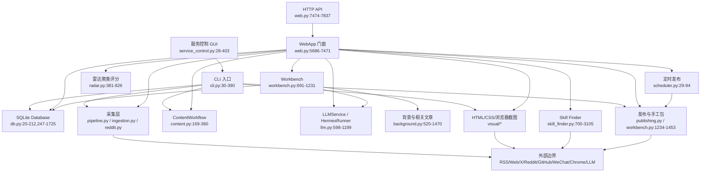

### 3.2 模块职责

| 层 | 模块 | 当前职责 |
|---|---|---|
| 入口 | src/autoposting/cli.py:30-112,252-390 | CLI 子命令、参数校验、JSON 输出 |
| 入口 | service_control.py:28-286,295-407 | GUI 启停本地服务、PID/端口安全检查 |
| HTTP | src/autoposting/web.py:7474-7837 | 路由、请求校验、错误映射、静态首页 |
| 应用门面 | src/autoposting/web.py:5686-7471 | 采集、文章、Skill、渲染、设置、发布编排 |
| 持久化 | src/autoposting/db.py:20-212,247-1725 | schema、迁移、读写、幂等、部分领域规则 |
| 采集 | src/autoposting/pipeline.py:41-129 | due 判断、并发调度、来源错误汇总 |
| 来源适配 | ingestion.py、reddit.py | RSS/Web/Sitemap/X/Reddit 抓取和解析 |
| 雷达 | radar.py:381-826 | 候选聚类、重要性/关注度、证据包 |
| 文章工作台 | workbench.py:691-1231 | 原文、背景、相关搜索、文章、图片资产 |
| 内容状态机 | content.py:169-360 | facts、draft、编辑、审核、状态流转 |
| 模型 | llm.py:598-1199 | 模型配置、缓存、翻译、生成、聊天 |
| Skill | skill_finder.py:700-3105 | 关键词、搜索、聚合、降级、文章与包 |
| 视觉 | visual/pipeline.py、visual/weekly.py | schema → HTML → PNG |
| 发布 | publishing.py:26-160、workbench.py:1250-1453 | 本地包、归档、微信公众号草稿 |
| 调度 | scheduler.py:29-94 | 轮询、claim、发布、完成/失败 |

### 3.3 主要持久化契约

schema 位于 src/autoposting/db.py:20-212。

| 表 | 作用 | 关键边界 |
|---|---|---|
| sources | 来源配置、抓取周期和最后错误 | source id/type/level |
| items / item_sources | 内容与多来源关联 | external id、canonical URL、content hash 去重 |
| events / claims / drafts | 事实、事件、文章草稿状态机 | 部分状态仅由应用代码约束 |
| engagement_snapshots | 雷达历史互动数据 | event_id 未见外键约束 |
| llm_cache | 模型任务缓存 | task/model/prompt 组合 |
| publication_attempts | 发布幂等和结果 | platform/status 无数据库 CHECK |
| model_endpoints / model_endpoint_purposes | 模型端点和用途 | 存在旧表重建迁移 |
| github_weekly | 周榜、图片计划和视觉状态 | repos/images/visual 为自由 JSON |
| skill_finder | 单行 Skill Finder 快照 | 整体 payload 为自由 JSON |
| scheduled_jobs | 定时发布任务 | status 有 CHECK，result 为自由 JSON |

## 4. 代码级程序执行流程图

## 4.1 CLI 命令总入口

证据：src/autoposting/cli.py:30-112,252-390。

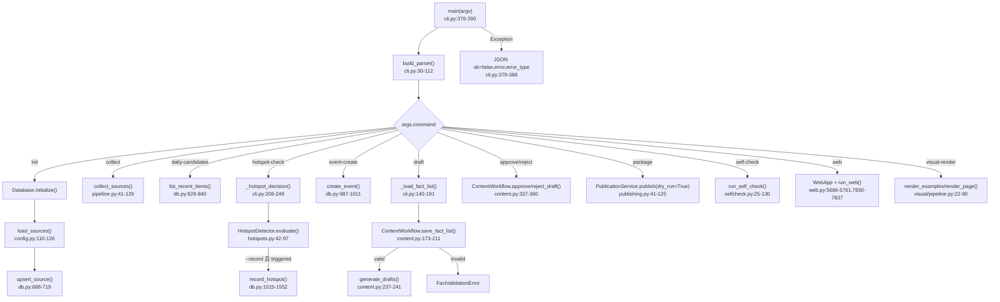

注意：CLI hotspot-check 使用 HotspotDetector；Web collect 使用 radar.rank_events。CLI draft 是 facts-first；Web articles 是 item-first LLM 工作台，两组链路并存。

## 4.2 Web 服务启动与路由

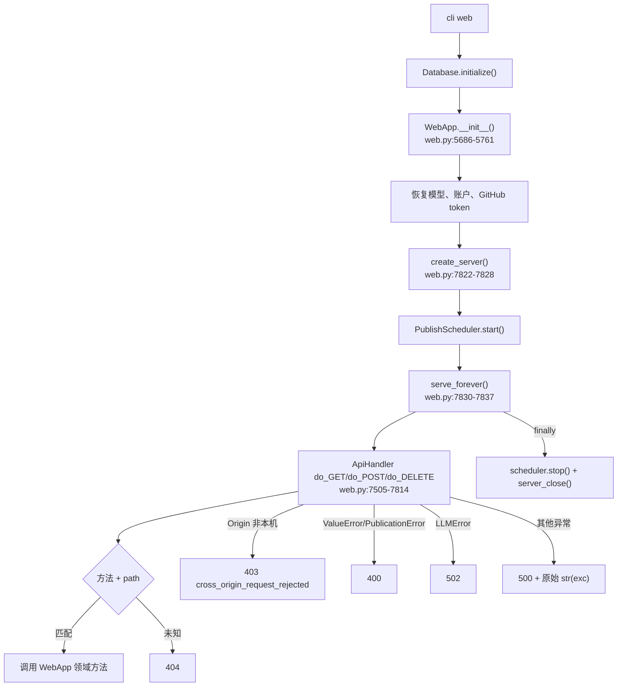

## 4.3 来源采集、热点雷达与候选窗口

证据：workbench.py:466-688、pipeline.py:41-129、radar.py:729-782。

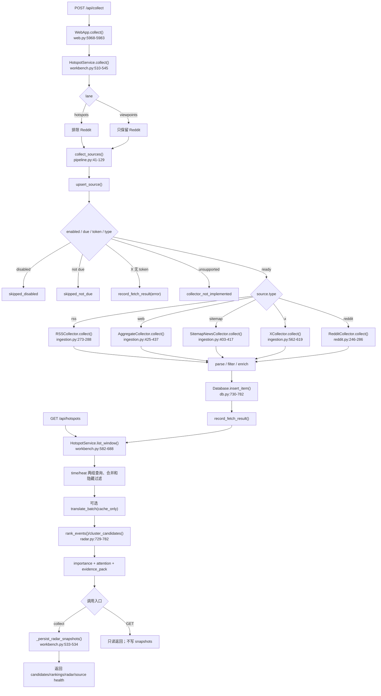

## 4.4 原文读取与翻译

证据：web.py:6090-6221、reader.py、llm.py:801-1000。

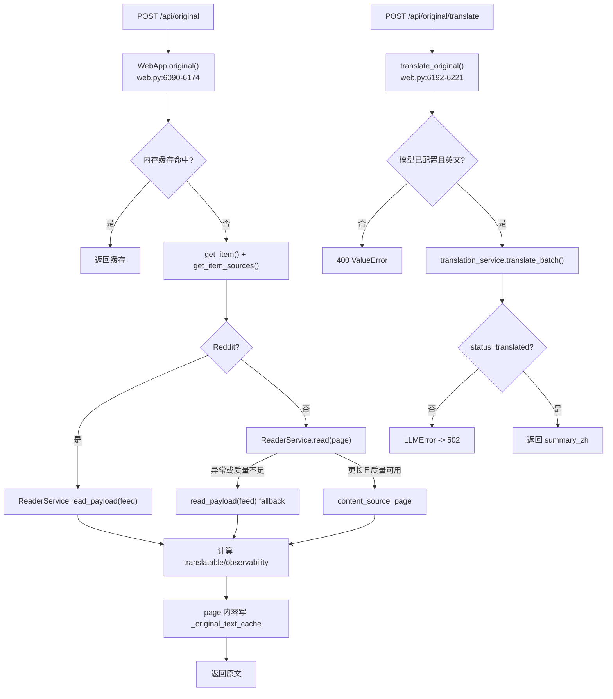

## 4.5 相关文章搜索

证据：background.py:1100-1396、workbench.py:739-806、web.py:6066-6088。

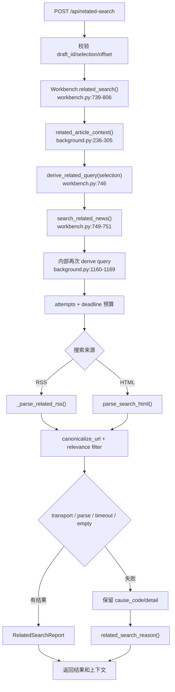

该链路对 transport failure、parse failure、budget exhausted 和 no qualified result 的错误建模较好，是项目内可复用的正面样例。

## 4.6 文章生成

证据：workbench.py:808-1207、content.py:169-360、llm.py:1091-1199。

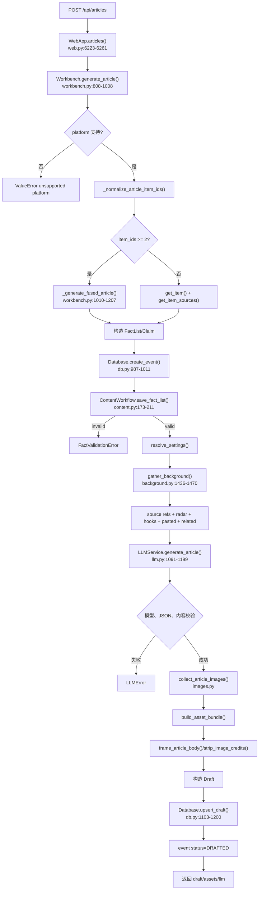

## 4.7 文章编辑、图片和审核

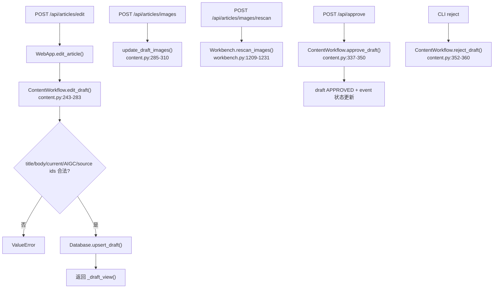

## 4.8 GitHub Weekly 获取

证据：github_weekly.py:416-522、web.py:6460-6471。

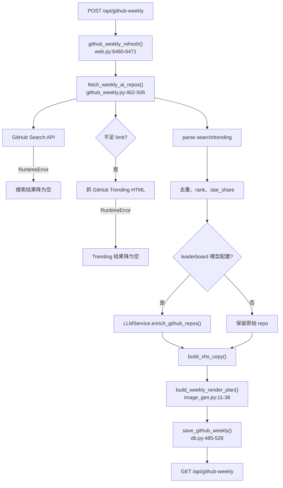

## 4.9 GitHub Weekly HTML/PNG 渲染

证据：visual/weekly.py:18-115、visual/pipeline.py:22-62、visual/screenshot.py:69-189。

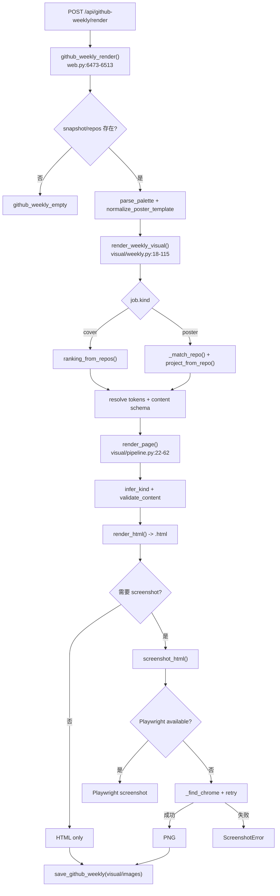

当前符合项目约束：image_gen.py 只生成页面 job plan，真实视觉产物走 HTML/CSS 和浏览器截图，没有新增图片模型调用。

## 4.10 Skill Finder 搜索与写包

证据：web.py:6798-6925、skill_finder.py:700-997,1782-1878。

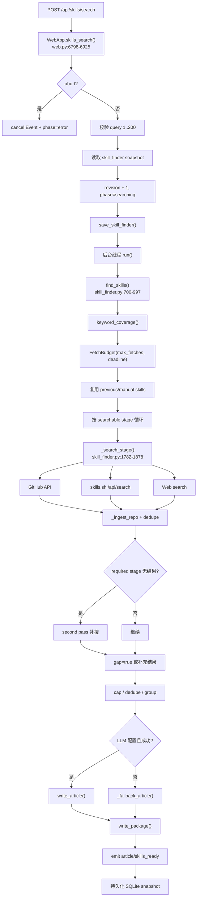

## 4.11 Skill Package 渲染

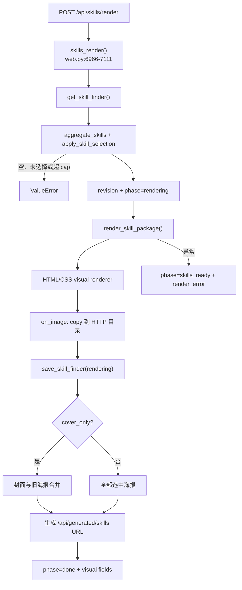

revision 仅是应用层并发保护，不是数据库约束；单进程本地服务成立，跨进程部署不安全，证据见 web.py:6935-6964。

## 4.12 发布

证据：web.py:7348-7415、publishing.py:41-125、workbench.py:1415-1453。

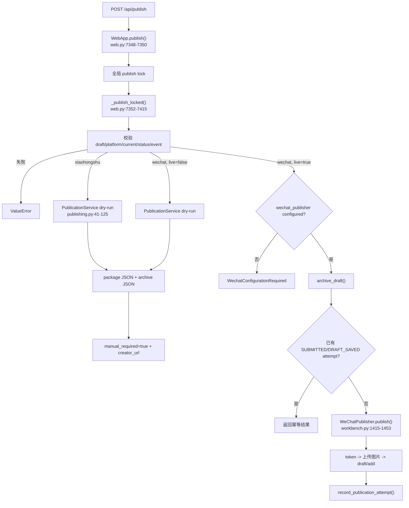

能力边界：

- Xiaohongshu 只生成手工包，符合项目明确约束。
- X 只有采集 token/collector 和账户配置，未发现 X 发布适配器；这不是隐藏实现，而是当前能力缺口。
- PublicationService 明确拒绝非 dry-run；真实微信草稿发布只从 WebApp live=true 进入 WeChatPublisher。

## 4.13 定时发布

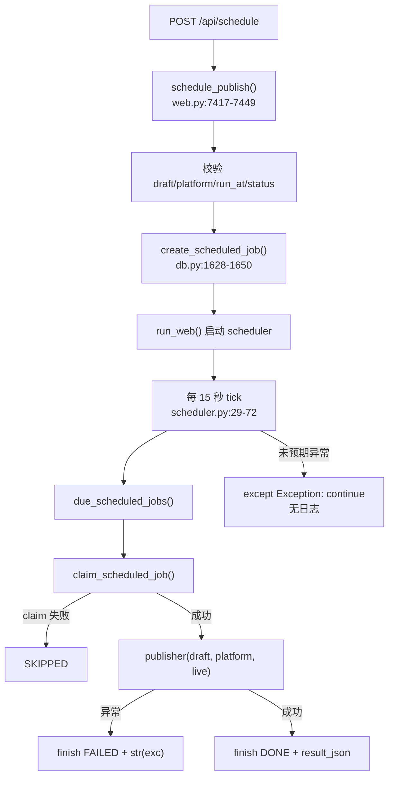

## 4.14 平台设置、模型端点与密钥

证据：web.py:5819-5899,6331-6441,7276-7346、llm.py:147-237。

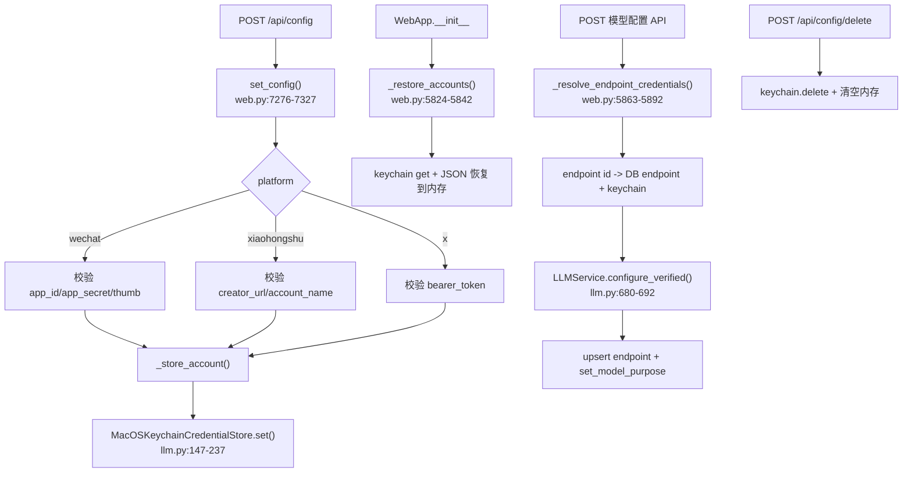

未发现 API key/AppSecret 被直接写入 SQLite 的证据；tests/test_web.py:1363-1367 还验证密钥不会出现在数据库和 API 响应中。

## 4.15 服务控制与自检

证据：service_control.py:28-286,295-407、selfcheck.py:25-130。

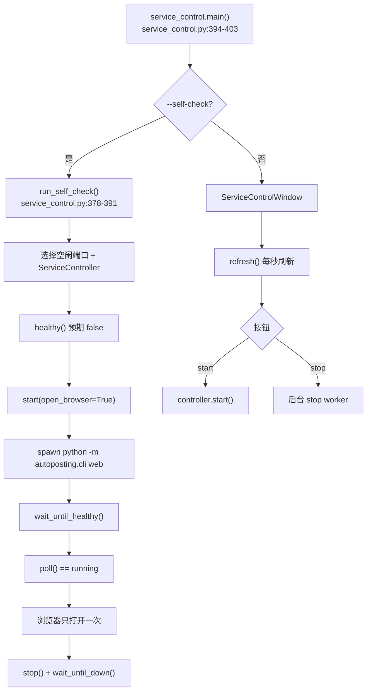

ServiceController 会用 lsof/ps 和工作目录校验目标 PID，降低误停其他进程的风险，见 service_control.py:112-133,215-260。

## 4.16 服务状态查询

证据：web.py:5917-5966,7515-7517。

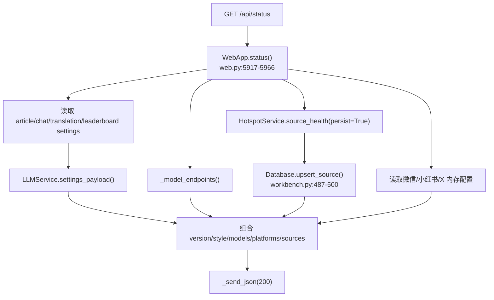

## 4.17 热点 Hooks 查找

证据：web.py:6063-6064,7641-7642、workbench.py:706-737、hooks.py:232-287。

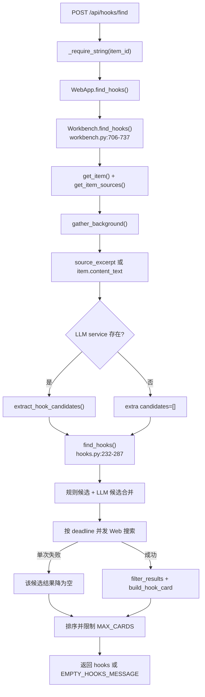

## 4.18 收藏增删查

证据：web.py:6040-6061,7524-7525,7647-7648,7804-7805、db.py:600-676。

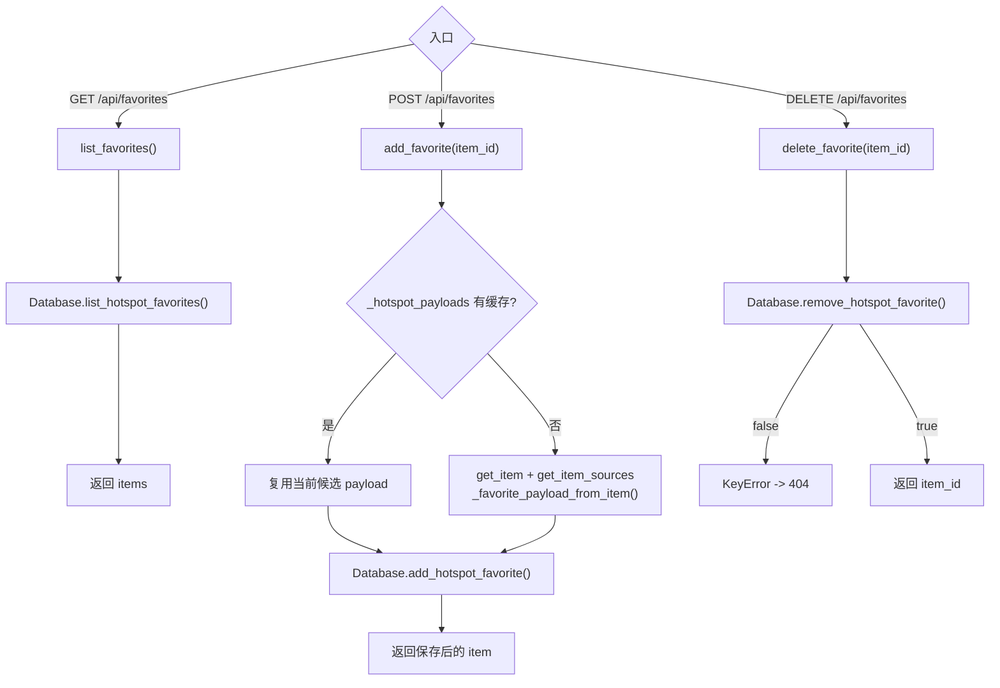

## 4.19 模型发现、用途绑定与删除

证据：web.py:6331-6441,7201-7261,7687-7716、llm.py:677-692。

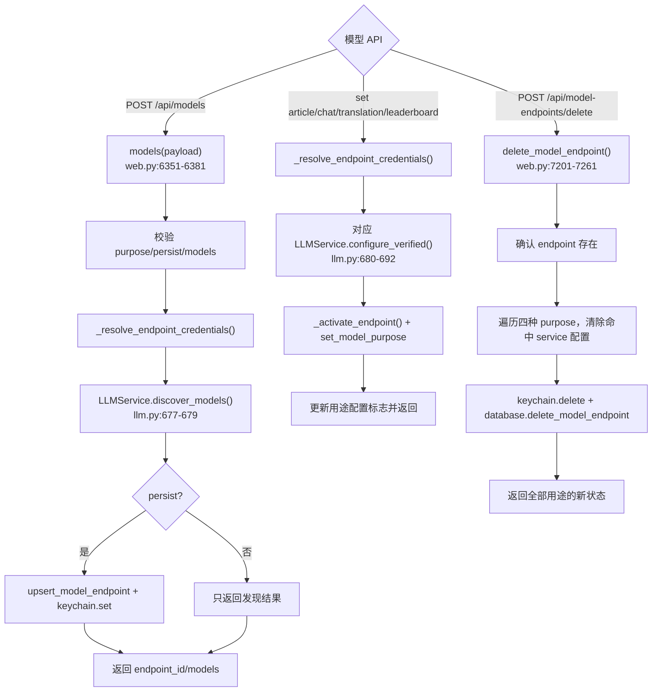

## 4.20 对话

证据：web.py:7263-7265,7717-7721、llm.py:240-269,695-706。

```mermaid
flowchart TD
    A["POST /api/chat"] --> B["读取 messages/model"]
    B --> C["validate_chat_messages()<br/>llm.py:240-269"]
    C -->|结构、角色、长度非法| D["ValueError -> 400"]
    C -->|合法| E["chat_service.chat()<br/>llm.py:695-706"]
    E --> F["resolve_settings(model override)"]
    F --> G["runner.chat(messages, settings)"]
    G -->|LLMError| H["502 稳定错误 payload"]
    G -->|成功| I["assistant content"]
    I --> J["返回 message role=assistant"]
```

## 4.21 Skill 链接粘贴

证据：web.py:6648-6724,7705-7706、skill_links.py:317-343。

```mermaid
flowchart TD
    A["POST /api/skills/paste"] --> B["skills_paste()<br/>web.py:6648-6724"]
    B --> C["校验 links 长度"]
    C --> D{"search/render 正在运行?"}
    D -->|是| E["ValueError"]
    D -->|否| F["parse_skill_links()<br/>skill_links.py:317-343"]
    F --> G["限制 MAX_PASTE_LINKS，记录 rejects"]
    G --> H{"有候选?"}
    H -->|否| I["返回当前 skills_snapshot + rejects"]
    H -->|是| J["fetch_manual_hits()<br/>锁外网络请求"]
    J --> K["_skill_lock()"]
    K --> L["读取最新 snapshot"]
    L --> M["merge_manual_hits()<br/>复用 LLM/fallback 写作"]
    M --> N["save_skill_finder()"]
    N --> O["返回 added/replaced/rejected/unverified"]
```

## 4.22 Skill 快照、标题、清空与 GitHub Token

证据：web.py:6620-6646,6726-6796,7521-7523,7701-7708。

```mermaid
flowchart TD
    A{"入口"} -->|GET /api/skills| B["skills_snapshot()<br/>web.py:6620-6646"]
    B --> C["get_skill_finder()"]
    C --> C1{"article body 为空?"}
    C1 -->|是| C2["_restore_skill_article_from_package()<br/>index.json 或 article.md"]
    C2 -->|恢复成功| C3["Database.save_skill_finder()<br/>web.py:6601-6604"]
    C2 -->|无可恢复文件| C4["保持原 snapshot"]
    C1 -->|否| C4
    C3 --> C5["补 phase/defaults + source payload"]
    C4 --> C5
    C5 --> D["返回 snapshot"]
    A -->|POST /api/skills/title| E["set_skill_title()"]
    E --> F["校验 title <= 120"]
    F --> G["_skill_lock + 保存 user_title"]
    G --> D
    A -->|POST /api/skills/clear| H["clear_skills()"]
    H --> I{"search/render active?"}
    I -->|是| J["ValueError"]
    I -->|否| K["保留 user_title，清空 skills/article/images<br/>revision + 1"]
    K --> D
    A -->|POST /api/skills/github-token| L["save_github_token()"]
    L --> M["校验并 trim token"]
    M --> N{"空 token?"}
    N -->|否| O["Keychain.set + set_github_token"]
    N -->|是| P["Keychain.delete + 回退环境变量"]
    O --> Q["只返回 configured 布尔值"]
    P --> Q
```

## 4.23 GitHub Weekly 单图重渲染

证据：web.py:7113-7180,7697-7698。

```mermaid
flowchart TD
    A["POST /api/github-weekly/image"] --> B["github_weekly_image(id,payload)<br/>web.py:7113-7180"]
    B --> C["get_github_weekly()"]
    C -->|无 snapshot| D["github_weekly_empty"]
    C --> E["在 images 中匹配 id"]
    E -->|未找到| F["KeyError -> 404"]
    E --> G{"kind=cover?"}
    G -->|否| H["require_enriched_copy(repos)"]
    G -->|是| I["跳过 enriched copy 检查"]
    H --> J["payload 覆盖或复用 visual theme/palette/template"]
    I --> J
    J --> K["render_weekly_visual([match]) 或注入 renderer"]
    K -->|空结果| L["image_generation_failed"]
    K -->|成功| M["替换 images 中对应项"]
    M --> N["save_github_weekly(updated, visual)"]
    N --> O["返回单图信息和 repo count"]
```

## 4.24 调度任务列表与取消

证据：web.py:7451-7471,7547-7548,7750-7753、db.py:1661-1725。

```mermaid
flowchart TD
    A{"入口"} -->|GET /api/schedule| B["list_schedule()<br/>web.py:7451-7465"]
    B --> C["Database.list_scheduled_jobs()"]
    C --> D["转换 live/status/error_message"]
    D --> E["返回 jobs"]
    A -->|POST /api/schedule/cancel| F["cancel_schedule(payload)<br/>web.py:7467-7471"]
    F --> G["校验 job_id"]
    G --> H["Database.cancel_scheduled_job()<br/>db.py:1713-1725"]
    H -->|不存在/不可取消| I["KeyError/ValueError -> 4xx"]
    H -->|成功| J["status=CANCELLED"]
    J --> K["返回 job_id/status"]
```

## 4.25 写作风格覆盖

证据：web.py:7267-7274,7722-7723。

```mermaid
flowchart TD
    A["POST /api/style"] --> B["set_style(payload)<br/>web.py:7267-7274"]
    B --> C["校验 style 为字符串"]
    C --> D{"长度 <= 50000?"}
    D -->|否| E["ValueError -> 400"]
    D -->|是| F["self.article_style = style"]
    F --> G["后续文章生成作为最高优先 prompt overlay"]
    F --> H["返回 style"]
    I["服务重启"] --> J["内存 style 丢失"]
```

## 4.26 远程图片代理

证据：web.py:6319-6329,7570-7578。

```mermaid
flowchart TD
    A["GET /api/image-proxy?url=..."] --> B["WebApp.proxy_image()<br/>web.py:6319-6329"]
    B --> C{"http/https 且长度 <= 2000?"}
    C -->|否| D["image_url_invalid -> 400"]
    C -->|是| E["Workbench.image_fetcher 或 download_image"]
    E --> F{"返回非空 bytes?"}
    F -->|否| G["image_unavailable -> 400"]
    F -->|是| H["guess_image_content_type(data)"]
    H --> I["200 bytes + private max-age=300"]
```

## 4.27 生成图片读取

证据：web.py:7182-7199,7550-7568。

```mermaid
flowchart TD
    A["GET /api/generated/{collection}/{name}"] --> B["generated_image(name, collection)<br/>web.py:7182-7199"]
    B --> C["Path(name).name + .png 校验"]
    C -->|失败| D["image_url_invalid -> 400"]
    C -->|成功| E["resolve 目标目录并检查 root containment"]
    E --> F{"文件存在?"}
    F -->|是| G["read_bytes()"]
    F -->|否且 skills| H["读取 skill snapshot.package_path/images fallback"]
    H -->|存在| G
    H -->|不存在| I["KeyError -> 404"]
    F -->|否且 weekly| I
    G --> J["200 image/png + no-store"]
```

## 5. 深度问题清单

### 5.1 同一件事多处重复实现

#### [高] 发布前置校验重复

- publishing.py:42-72 的 publish 检查 current draft、draft status、event status。
- publishing.py:127-136 的 archive_draft 再做相同检查。
- publish 在 publishing.py:84 调用 archive_draft，正常路径必然重复。

archive_draft 作为公开入口独立防御是合理的；问题是内部调用没有“已验证上下文”契约，未来修改状态规则需要同步两份。

#### [中] 单项和融合文章生成存在平行管线

- workbench.py:808-1008：单 item。
- workbench.py:1010-1207：多 item 融合。
- 两者输入语义不同，分别承担单项写作和多项融合；相似点集中在来源记录、图片、正文 framing、Draft 构造和入库等公共尾段。
- CLI facts-first 链路 cli.py:293-306 + content.py:169-241 又形成第三种入口语义。

#### [中] HTTP 安全校验和错误响应重复

- POST Origin/Content-Type：web.py:7590-7614。
- DELETE Origin/Content-Type：web.py:7778-7802。
- GET/POST/DELETE 各自实现 KeyError、ValueError 和通用异常映射。

#### [中] Skill 图片文件复制和 URL 转换重复

- web.py:7017-7028：增量 publish_images。
- web.py:7089-7097：渲染结束后再次复制并生成 URL。

### 5.2 模块职责不清

#### [严重] web.py 是前后端与应用层混合单体

- web.py:94-5683：约 5,590 行内嵌 HTML/CSS/JavaScript。
- web.py:5686-7471：WebApp 同时负责缓存、账户、模型、热点、文章、Skill、渲染、发布和调度。
- web.py:7474-7819：HTTP handler、路由、协议校验和错误映射。
- do_POST 位于 web.py:7588-7774，共 187 行宽分支。

WebApp 作为 façade 本身不是问题；当前 façade 同时承担依赖容器、状态恢复和多个领域服务职责，已经超出清晰边界。

#### [高] workbench.py 混合三个业务域

- workbench.py:466-688：热点采集、来源健康、radar、翻译。
- workbench.py:691-1231：文章、原文、背景、相关文章和图片。
- workbench.py:1250-1453：微信 API、素材上传和发布。

#### [高] Database 既是仓储又是领域服务

- db.py:247-1725：一个类覆盖所有领域表。
- db.py:1327-1438：list_hotspot_candidates 在 SQL 后执行 lane 过滤、来源判断、隐藏规则、engagement 和 tier。
- db.py:1374：数据库模块反向导入 ingestion。

集中 SQLite 访问是合理的；把热点分类和排序决策放进数据层则造成反向耦合。

### 5.3 隐藏式自动修复过多

#### [高] 数据库损坏静默转为空数据

- db.py:536-562：github_weekly 三个 JSON 字段解析失败后变为 [] 或 {}。
- db.py:591-600：skill_finder payload 解析失败后变为 {} 并补默认字段。
- db.py:655-673：favorite payload 损坏后继续返回空 payload。

容错防崩溃有价值，但当前没有 degraded 标记、日志或稳定错误码，用户看到的只是“没有数据”。

#### [高] Skill 快照读取会自动恢复并写回

- web.py:6532-6564：_merge_latest_skill_fields 自动恢复 article/images/user_title/visual/phase/revision。
- web.py:6566-6605：GET 快照时从 index.json 或 article.md 恢复文章并写回数据库。
- skill_finder.py:1573-1630：_reuse_previous 把旧技能重新归档到新 stage，并设为 verified。
- skill_finder.py:895-897：每次搜索自动重新注入 manual skills。

问题不是恢复本身，而是读取、迁移、合并和正常更新没有不同结果类型，来源和时效性不透明。

#### [中] LLM 与外部服务失败被自动补丁

- skill_finder.py:968-980：LLM 失败后机械文章。
- skill_finder.py:1242-1263：缺 source id 或 AIGC 标记时自动追加。
- github_weekly.py:481-497：GitHub API/Trending 失败后空结果。
- web.py:6132-6159：原站读取失败回退 feed。
- reddit.py:246-286：评论失败仍保留帖子。
- reader.py:854-873、images.py:412-443：部分失败直接降级或 pass。

应区分“业务允许的降级”和“数据损坏/编程错误”。当前两者在可观测性上过于接近。

### 5.4 重复检查和重复转换

#### [中] 热点参数校验分散，错误文本未共享

- web.py:7530-7542：GET hotspots。
- web.py:7617-7634：POST collect。
- workbench.py:518-523：HotspotService.collect。
- workbench.py:585-590：HotspotService.list_window。

HTTP 信任边界和服务层各保留一次校验是合理的；当前问题是逻辑和错误文本没有共享契约。

#### [中] 发布 JSON 重复拼装

- publishing.py:96-107：publication package。
- publishing.py:143-154：article archive。
- title/body/tags/assets/source ids/content hash 的读取和序列化重复。

#### [中] 视觉参数解析分散

- web.py:6477-6484：GitHub weekly render。
- web.py:6971-6978：Skill render。
- web.py:7123-7144：weekly image 兼容 fallback。

三条入口对 theme、palette、template 的默认和合并策略不同，参数语义容易漂移。

### 5.5 模块强耦合

#### [高] WebApp 同时是依赖容器和业务门面

- web.py:5687-5703：构造函数约 15 个依赖参数。
- web.py:5708-5759：内部继续创建多个 LLMService、HotspotService、Workbench、ContentWorkflow、PublishScheduler。
- web.py:10-64：直接导入数据库、LLM、渲染、Skill、发布、阅读器和调度模块。

替换单一服务、隔离测试单一路由或改变生命周期，都需要理解 WebApp 的创建和恢复顺序。

#### [高] Skill 状态用无类型字典穿越三层

- db.py:564-598：dict JSON 保存和恢复。
- skill_finder.py:777-816：大量字符串键拼 snapshot。
- web.py:6532-6564：另一模块直接修改同一组键。

### 5.6 死代码和长期遗留

#### [低—中] decompose_coverage 是明确 legacy 候选

- skill_finder.py:1127-1211 明确标注 “Legacy AI coverage planner”。
- 静态调用图显示生产调用者为零，唯一调用来自 tests/test_skill_finder.py:937-950。
- 当前主链路使用 keyword_coverage，见 skill_finder.py:832-849。

不能在本次只读审查中断言可安全删除：它可能仍是外部导入兼容面。但应明确兼容期限，否则两套 coverage 会长期共存。

其他并行实现仍有实际入口，不能归为死代码：

- hotspots.py 的 HotspotDetector 仍由 CLI hotspot-check 使用。
- ContentWorkflow facts-first 仍由 CLI draft 使用。
- image_gen.py 虽命名误导，但仍生成 GitHub weekly render plan。

### 5.7 魔法规则和硬编码

#### [中] Skill 规则集中度不足

- skill_finder.py:28-47：SKILL_KIND_RULES。
- skill_finder.py:61-70：WORKFLOW_STAGES。
- skill_finder.py:2621-2644：名称/描述/正文固定权重 5/2/1。
- skill_finder.py:1000-1003：关键词上限固定 6。

这些是产品规则，不是无意义数字；风险在于没有统一规则版本和解释性输出，改变分类或语言需要改代码。

#### [中] 视觉阈值部分仍在源码

- visual/rules.py:37：名称截断 28。
- visual/rules.py:42：progress 下限 0.08。
- visual/rules.py:45-46：标题/副标题长度 24。
- visual/rules.py:84：caption 42。
- visual/rules.py:88：story 上限 6。
- visual/rules.py:48：8 个项目切换 density。

一部分规则已经进入 rules.json，另一部分仍在 Python，配置边界不一致。

#### [中] 版本和状态字符串散布

- 版本号：pyproject.toml:7、__init__.py:3、web.py:66,1071、llm.py:42、tests/test_web.py:365,2242。
- draft/event/publication/scheduled/skill phase 状态分散在 db.py、content.py、publishing.py、scheduler.py、web.py。
- platform/lane/time/heat 等字符串在路由、服务、数据库和前端重复出现。

### 5.8 函数过大、文件过大、嵌套过深

| 文件/函数 | 行数 | 判断 |
|---|---:|---|
| web.py | 7,837 | 前端、API、应用层混合，严重 |
| skill_finder.py | 3,105 | 搜索、状态、文章、落盘混合 |
| db.py | 1,725 | 多领域仓储单体 |
| background.py | 1,470 | 多种检索/背景策略集中 |
| workbench.py | 1,453 | 热点、文章、发布混合 |
| llm.py | 1,199 | 模型适配和多任务集中 |
| reader.py | 1,017 | 多解析路径集中 |
| _make_handler | 346 | handler 工厂过大 |
| find_skills | 298 | 严重：跨搜索、降级、生成、落盘 |
| generate_article | 201 | 文章生成职责过多 |
| _generate_fused_article | 198 | 多源融合与生成混合 |
| do_POST | 187 | 路由、校验、错误映射混合 |
| ReaderService.read | 185 | 多路径解析 |
| skills_render | 146 | 状态、选择、渲染、文件发布 |
| merge_manual_hits | 131 | 合并、分组、文章、写包 |

结论：真实风险主要是函数过长、分支过宽和职责混合。AST 统计会把 do_POST 的长 elif 链显示为很深，但不应误报为 34 层真实嵌套；局部存在 4—6 层控制嵌套，未发现全项目普遍的极深嵌套。

### 5.9 缺少稳定数据契约

#### [高] 持久化 JSON 无 schema version

- db.py:485-562：GitHub repos/images/visual 自由 JSON。
- db.py:564-598：Skill payload 自由 JSON。
- db.py:1704-1711：scheduled result_json 无结构约束。
- 损坏时多数路径直接返回空对象，进一步隐藏契约漂移。

#### [中] SQLite 没有统一 migration version

- db.py:257-270：initialize 每次执行 SCHEMA 后运行多个 _ensure_*。
- db.py:278-338：通过建表 SQL 是否含 sitemap/reddit 判断旧形态。
- db.py:340-420：model_endpoint_purposes 连续重建。
- 未发现 PRAGMA user_version、migration ledger 或 schema version 表。

已有测试只覆盖 model purpose 和 sitemap 两类旧表迁移；未覆盖 GitHub weekly、Skill、favorite、engagement 等完整升级矩阵。

#### [中] 状态和渠道缺少数据库约束

- items/events/claims/drafts/publication_attempts 的部分 status/platform 无 CHECK，见 db.py:50-158。
- scheduled_jobs.status 有 CHECK，说明项目已有可复用的数据库约束做法，见 db.py:204-208。
- engagement_snapshots.event_id 未见 REFERENCES events(event_id)。

#### [中] API 用 default=str 隐式转换未知类型

- web.py:7476-7482：json.dumps(..., default=str) 会把 Path、日期或意外对象静默变成字符串。
- llm.py:662-675：settings_payload 标注 dict[str, str]，实际包含 bool。

#### [中] WeChat 响应契约不足

- workbench.py:1271-1288：_api 直接 json.loads 后 payload.get。
- 非法 JSON 会抛出 JSONDecodeError；非对象 JSON 会在 payload.get() 处抛出 AttributeError；token/draft 响应缺少必需字段时会在调用方抛出 KeyError，这些情况均未统一转换为稳定的 PublicationError。上传响应缺少 media_id/url 则会转为 PublicationError。
- 已覆盖已知/未知 errcode 和网络错误；未覆盖非法 JSON、非对象 JSON和关键字段缺失。

### 5.10 改需求必须全项目搜索

以下需求变化当前都需要跨文件搜索：

1. 版本：5 个生产/测试位置加项目规则。
2. 新平台：前端选项、Web 路由、article_prompt、Workbench、DB CHECK、publishing、scheduler。
3. 新状态：schema、ContentWorkflow、PublicationService、WebApp、前端 phase/status。
4. hotspot lane/hours：handler、HotspotService、Database、前端。
5. Skill phase/snapshot 字段：db.py、skill_finder.py、web.py、前端、测试。
6. theme/palette/template：weekly、Skill、兼容读取和视觉层。

根因不是“搜索工具不好用”，而是相同概念没有单一契约源。

### 5.11 自动化测试

#### 正面结论

- 30 个 test_*.py。
- 发现 595 个可运行测试项。
- CLI、DB、配置、ContentWorkflow、scheduler、publishing、Web、LLM、Skill Finder、reader、ingestion、GitHub weekly、Reddit、visual 均有测试。
- 事实校验、draft 审批、发布幂等、LLM 解析/缓存、GitHub 错误分类和 token 不泄漏、related-search 脱敏、WeChat 已知错误均覆盖较好。

因此“项目缺少自动化测试”不成立。

#### [中] 前端主要是静态契约测试

- tests/test_web.py:1924-3069 的 IndexPageContractTests 大量使用 assertIn/assertNotIn 检查 HTML/JS 字符串。
- tests/test_web.py:2391-2404 只用 JavaScript parser 验证语法。
- 未发现真实浏览器点击、刷新恢复、异步竞态和错误展示的自动化端到端测试。

这与 AGENTS.md 的功能验收标准存在距离：元素和函数名存在不等于交互成功。

#### [中] 部分 API 缺真实 HTTP 行为覆盖

- /api/leaderboard/model 主要出现在页面字符串测试。
- /api/model-endpoints/delete 主要出现在页面字符串测试。
- /api/articles/images/rescan 主要出现在页面契约测试。

#### [中] scheduler 失败路径未覆盖

- tests/test_scheduler.py:42-59 覆盖时间解析、成功发布和未来任务。
- scheduler.py:74-94 的 publisher 异常和数据库失败状态缺直接测试。
- _loop 的通用异常吞掉行为无测试。

#### [中] 迁移测试矩阵不完整

已测试 model endpoint purpose、sitemap source type；未见 GitHub weekly、Skill、favorite、engagement、多阶段迁移中断恢复的完整覆盖。

### 5.12 日志和错误信息

#### [高] Scheduler 静默吞掉所有未预期异常

- scheduler.py:57-62：try tick / except Exception / continue。
- publisher 异常只保存 str(exc)，没有 traceback、错误码或上下文，见 scheduler.py:86-88。

数据库异常或线程异常可能让任务长期停在 PENDING/RUNNING，操作员只看到“没有继续发布”。

#### [高] HTTP 500 暴露内部文本但没有服务端诊断链

- GET：web.py:7585。
- POST：web.py:7773。
- DELETE：web.py:7813。
- log_message 在 web.py:7816-7817 完全 pass。

结果同时具备两个坏处：客户端可能收到路径、数据库或第三方内部文本；服务端又没有 route、request id、traceback 和结构化上下文。

#### [中] 采集错误原样进入数据库和 API

- ingestion.py:284-285,413-415,433-435,615-617。
- pipeline.py:104-112。

异常文本没有统一 error code、source/type 上下文和脱敏边界，可能把 URL 或底层细节写进 sources.last_error。

#### [中] 降级路径可观测性不一致

- related search 有 cause_code、detail 和脱敏日志，是正面样例。
- reader、images、WeChat 图片上传/海报生成存在 pass 或只返回降级结果，见 reader.py:854-873、images.py:412-443、workbench.py:1363-1413。
- skills.sh adapter 仅写 debug 且包含 URL/异常文本，见 skill_finder.py:2017-2028。

## 6. 正面设计与误报排除

1. 密钥：未发现把 API key/AppSecret 明文写入 SQLite；使用 macOS Keychain，并有不回显测试。
2. SQL：connect() 启用 SQLite foreign keys，见 db.py:251-255；项目并非完全没有数据库约束。
3. 视觉契约：visual/schema.py 已建立内容 schema；“没有契约”主要针对跨层快照和 API，不应扩大为全项目。
4. LLM 错误：LLMError 已提供 code/cause_code/reason，见 llm.py:121-128。
5. 微信错误：已知 API errcode 有集中映射，见 workbench.py:1238-1247。
6. 相关文章：错误分类、预算和脱敏明显优于其他 fallback 路径。
7. 服务控制：PID、端口和工作目录校验降低误停风险。
8. 多数 fallback 有真实产品价值；问题在于原因和质量等级不统一，不是要求全部删除。
9. Database 集中 SQLite 访问和 WebApp façade 都是可接受模式；风险来自职责越界和规模，而非模式名称本身。
10. 没有证据证明存在“大量死代码”或“完全没有测试”。

## 7. 优先治理顺序（本次不实施）

### P0：先恢复可观测性和边界安全

1. scheduler 通用异常必须有结构化日志、job id、阶段和 traceback；避免永久静默。
2. HTTP 500 对客户端返回稳定错误码，对服务端保留 request/path/context；不要直接回传原始异常。
3. JSON 损坏与正常空状态分离，至少提供 degraded/fallback_reason。

### P1：建立稳定契约

1. 为 Skill/GitHub/scheduled result 持久化 JSON 增加 schema_version 和严格读取边界。
2. 用单向 migration ledger 或 PRAGMA user_version 取代 SQL 字符串探测。
3. 集中定义 platform、lane、draft/event/publication/scheduled/skill phase 状态。
4. 在 HTTP 边界停止 default=str 对未知类型的无条件吞并。

### P2：拆解两个严重中心

1. 把 web.py 的静态前端资源、HTTP 协议层和领域 application service 分开。
2. 把 find_skills 拆成 coverage/search orchestration、result aggregation、article/package 三个可独立验证阶段。
3. 让 Database 只负责数据访问，把 hotspot 分类/排序移回领域层。

### P3：合并重复管线

1. 统一单项/融合文章的 context → assets → Draft 持久化尾段。
2. 统一发布前校验和 package/archive payload 构造。
3. 统一 theme/palette/template 解析和图片文件到 URL 的发布动作。

### P4：补测试而不是盲目扩充测试数量

1. 浏览器级验证收集、刷新保留、长文面板、Skill 异步取消/旧 revision。
2. scheduler publisher 异常和 _loop 未预期异常。
3. 非法持久化 JSON、旧库多版本迁移、迁移中断恢复。
4. 微信非法 JSON/非对象响应/缺少关键字段。

## 8. 最终判断

AutoPosting 已经不是一个“小而简单”的标准库 MVP；它实际上包含采集平台、内容工作台、视觉渲染器、Skill 搜索器和发布调度器五个子系统。功能广度与测试数量都已达到可持续演进的临界点。

当前存在两个严重结构问题：

1. web.py 把静态前端、HTTP、依赖容器和多个业务域压在一个 7,837 行文件中；
2. find_skills 把搜索、恢复、降级、文章、包和进度状态压在一个 298 行函数中。

其余高风险问题——隐式 JSON 契约、迁移无版本、fallback 不可观测、scheduler 吞错、状态和校验散布——彼此强化：任何需求变更都更容易扩散到多个文件，故障又难以从日志定位。

但需要避免两个误判：

- 本项目不是缺少自动化测试，而是缺少少量高价值的真实行为、竞态、失败和迁移测试；
- 本项目没有证据表明死代码泛滥，目前只有 decompose_coverage 是明确 legacy 候选，其他旧链路仍有实际入口。

本报告只做分析和编排，不包含任何修复。
